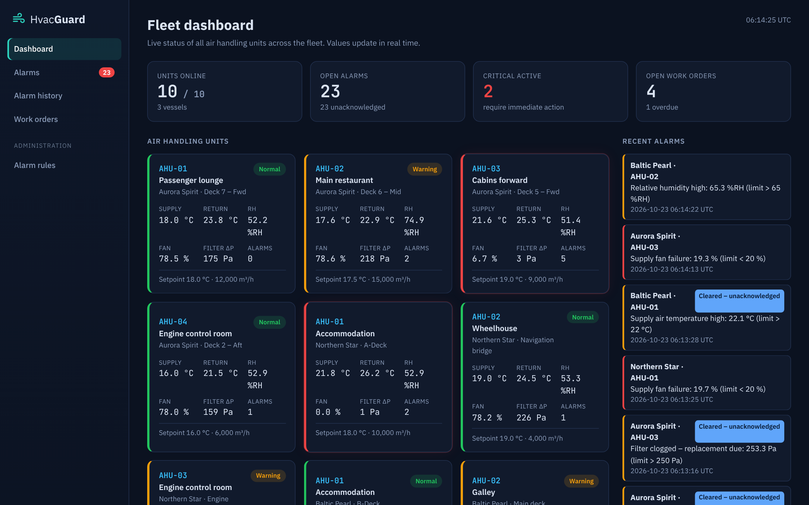
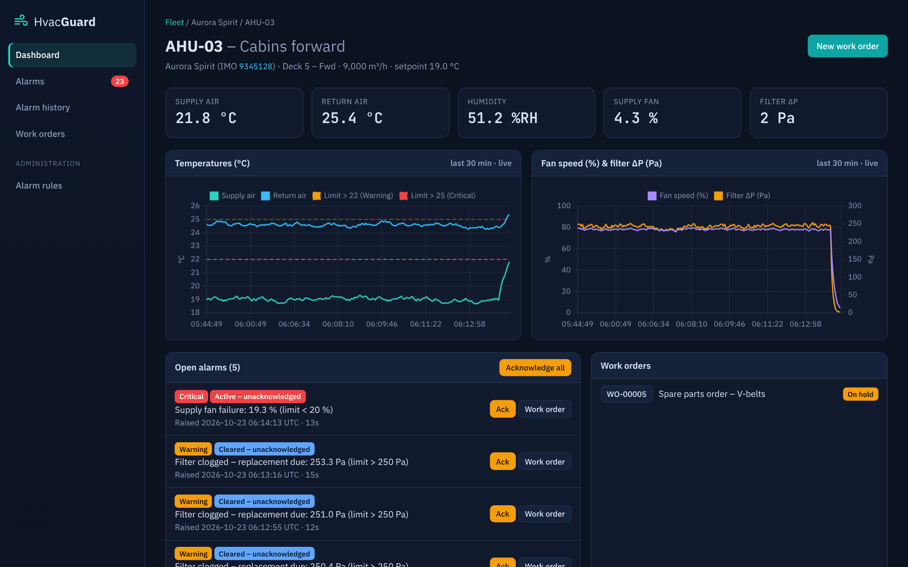
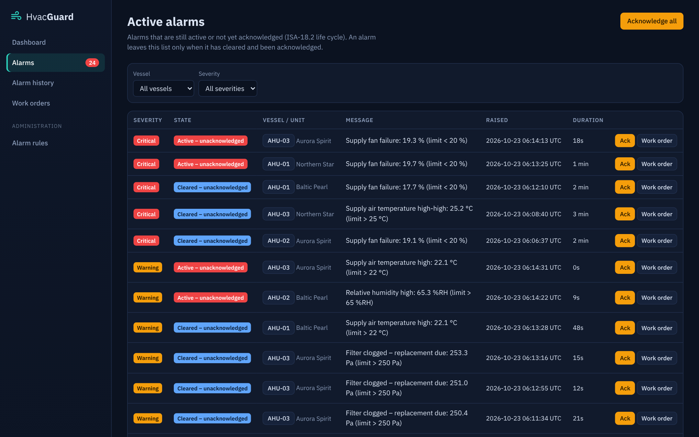
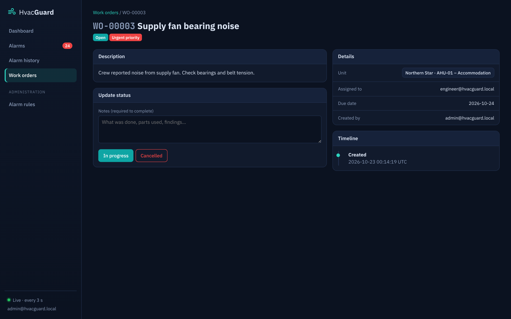
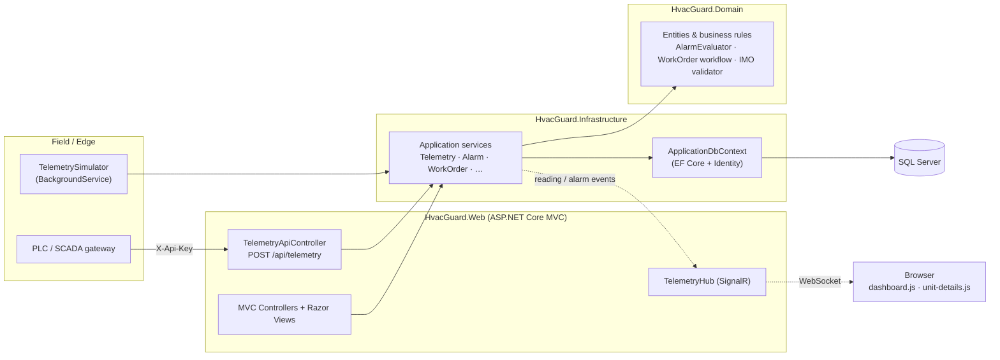

# HvacGuard – Marine HVAC Monitoring & Maintenance Platform


**HvacGuard** is a full-stack **ASP.NET Core MVC** application for monitoring the Air Handling Units (AHUs) of a ship
fleet in real time, managing alarms according to the **ISA-18.2** alarm life cycle and tracking maintenance with
**work orders**. It is based on my day-to-day work building SCADA/HMI screens for marine HVAC systems.

### [▶ Open the live demo](https://alicavuss.github.io/HvacGuard/) &nbsp;·&nbsp; [Demo accounts](#demo-accounts) &nbsp;·&nbsp; [5-minute code tour](#5-minute-code-tour)

> The **live demo** opens instantly in any browser: it reproduces the app's screens and alarm logic with simulated data.
> The **full application** (ASP.NET Core + SQL Server) is this repository – `docker compose up` or `dotnet run`.

| Fleet dashboard – live values via SignalR | Unit details – trends with alarm limits |
|---|---|
|  |  |
| **Active alarms – ISA-18.2 states, acknowledge** | **Maintenance work order** |
|  |  |

## At a glance

- **Stack:** C# · .NET 10 · ASP.NET Core MVC · Entity Framework Core 10 · SQL Server · ASP.NET Core Identity · SignalR · Chart.js · xUnit · Docker
- **Demonstrates:** layered architecture, rich domain model with business rules, real-time push to the browser, REST API secured with an API key,
  role-based authorization, background services, efficient EF Core queries, unit + integration tests, containerisation.
- **Domain knowledge:** ISA-18.2 alarm life cycle, deadband/hysteresis, IMO ship numbers (check digit), fan affinity law in the simulator.

## 5-minute code tour

| What to look at | Where |
|---|---|
| Alarm raise / clear logic – pure function, fully unit-tested | [`AlarmEvaluator.cs`](src/HvacGuard.Domain/Services/AlarmEvaluator.cs) |
| Work-order state machine (private setters, guarded transitions) | [`WorkOrder.cs`](src/HvacGuard.Domain/Entities/WorkOrder.cs) |
| Ingestion pipeline: store reading → evaluate rules → raise/clear alarms | [`TelemetryService.cs`](src/HvacGuard.Infrastructure/Services/TelemetryService.cs) |
| Real-time push with SignalR | [`RealtimeNotifier.cs`](src/HvacGuard.Web/Services/RealtimeNotifier.cs) · [`site.js`](src/HvacGuard.Web/wwwroot/js/site.js) |
| Background simulator (physical AHU model) | [`AhuSimulator.cs`](src/HvacGuard.Infrastructure/Simulation/AhuSimulator.cs) · [`TelemetrySimulator.cs`](src/HvacGuard.Web/Services/TelemetrySimulator.cs) |
| REST API + API-key filter | [`TelemetryApiController.cs`](src/HvacGuard.Web/Controllers/Api/TelemetryApiController.cs) · [`ApiKeyFilter.cs`](src/HvacGuard.Web/Filters/ApiKeyFilter.cs) |
| EF Core mapping (indexes, conversions, delete behaviours) | [`EntityConfigurations.cs`](src/HvacGuard.Infrastructure/Data/Configurations/EntityConfigurations.cs) |
| Composition root: Identity, policies, filters, SignalR | [`Program.cs`](src/HvacGuard.Web/Program.cs) |
| Tests | [`tests/HvacGuard.Tests`](tests/HvacGuard.Tests) |

---

## Features

| Area | What it does |
|------|--------------|
| **Live fleet dashboard** | KPI tiles and a card per AHU (supply/return temperature, humidity, fan speed, filter ΔP). Values update every few seconds via **SignalR** – no page refresh. Units turn amber/red on alarms and grey when offline. |
| **Unit details** | Live **Chart.js** trends (last 30 min) with alarm limits drawn on the chart, open alarms, work orders and active limits. |
| **Alarm management (ISA-18.2)** | Rules with threshold, severity and **deadband/hysteresis** (prevents alarm chattering). States: *Active-Unack → Active-Ack → Cleared-Unack → Closed*. Acknowledge one / all, real-time toasts, searchable history with paging and **CSV export**. |
| **Work orders** | Create from scratch or directly from an alarm (pre-filled). Enforced workflow *Open → In progress ⇄ On hold → Completed / Cancelled*, resolution notes required to complete, overdue detection, filters & paging. |
| **Fleet management** | CRUD for vessels (IMO number validated **with check digit**) and units (unique tag per vessel). |
| **Telemetry REST API** | `POST /api/telemetry` for PLC / SCADA / IoT gateways, protected by an **API key** header; `GET /api/units/{id}/readings`. OpenAPI document in development. |
| **Security** | ASP.NET Core **Identity**, cookie auth, global "authenticated by default" filter, role-based **policies** (Admin / Engineer / Viewer), anti-forgery tokens, lockout, constant-time API-key comparison. |
| **Simulator** | A `BackgroundService` with a small physical model of an AHU (first-order lag, sensor noise, filter clogging with ΔP ∝ airflow², random cooling / fan / humidity faults) feeds the same ingestion pipeline as the API, so the demo is alive out of the box. |
| **Ops** | Health check (`/health`), Docker + docker-compose (SQL Server), automatic data retention for telemetry. |

## Tech stack

- **Backend:** C# 14 / .NET 10, ASP.NET Core MVC, SignalR, Entity Framework Core 10, ASP.NET Core Identity
- **Database:** Microsoft SQL Server (LocalDB for development, SQL Server 2022 in Docker)
- **Frontend:** Razor views + Tag Helpers, Bootstrap 5.3 (custom dark "control room" theme), Chart.js, vanilla JavaScript
- **Testing:** xUnit, EF Core InMemory provider
- **DevOps:** Docker, docker-compose

## Architecture



The solution follows a **layered architecture** with dependencies pointing inwards:

```
src/
├── HvacGuard.Domain          # Entities, enums, business rules – no framework dependencies
│   ├── Entities              # Vessel, AirHandlingUnit, SensorReading, AlarmRule, Alarm, WorkOrder
│   ├── Services              # AlarmEvaluator (pure, unit-tested alarm logic)
│   └── Common                # DomainException, NotFoundException, ImoNumberValidator
├── HvacGuard.Infrastructure  # EF Core, Identity, application services, seeding, AHU simulation model
│   ├── Data                  # DbContext, Fluent API configurations, DbSeeder, DatabaseInitializer
│   ├── Services              # VesselService, UnitService, TelemetryService, AlarmService, WorkOrderService, …
│   └── Simulation            # AhuSimulator (physical model used for demo data)
└── HvacGuard.Web             # ASP.NET Core MVC presentation layer
    ├── Controllers (+ Api)   # Thin controllers, view models, policies
    ├── Filters               # DomainExceptionFilter (exceptions → 404 / 400 / redirect), ApiKeyFilter
    ├── Hubs                  # SignalR hub + message contracts
    ├── Services              # TelemetrySimulator, SignalR notifier, select lists
    └── Views / wwwroot       # Razor views, CSS, JavaScript
tests/
└── HvacGuard.Tests           # xUnit tests for domain rules and the ingestion pipeline
```

### Design decisions worth mentioning

- **Business rules live in the domain.** `WorkOrder` exposes `Start()`, `PutOnHold()`, `Complete()`, `Cancel()` and a
  private status setter, so an invalid transition is impossible from any controller. `AlarmEvaluator` is a pure
  function (reading + rules + active alarms → raised / cleared) and is fully unit tested.
- **One ingestion pipeline.** The simulator and the public API both call `ITelemetryService.IngestAsync`, which stores
  the reading, evaluates the rules and raises/clears alarms in a single `SaveChanges`.
- **Thin controllers.** Domain exceptions are translated centrally by `DomainExceptionFilter`
  (404 for missing records, 400 `ProblemDetails` for the API, a flash message for MVC pages).
- **Efficient queries.** `AsNoTracking` for reads, projections to DTOs (latest reading per unit via a correlated
  sub-query), composite indexes on `(UnitId, Timestamp)` for the time-series table, `ExecuteDeleteAsync` for retention.
- **SQL Server specifics.** Enum columns stored as readable strings where useful, `NO ACTION` on `WorkOrder → Alarm`
  to avoid multiple cascade paths, connection resiliency enabled.
- **Culture-safe.** Engineering values always use `.` as decimal separator (`en-US` request culture), which matters on
  servers with Turkish or German locale.

## Getting started

### Option 1 – Visual Studio / `dotnet run` (Windows, SQL Server LocalDB)

Requirements: [.NET 10 SDK](https://dotnet.microsoft.com/download) and SQL Server LocalDB (installed with Visual Studio).

```bash
git clone https://github.com/AliCavuss/HvacGuard.git
cd HvacGuard
dotnet run --project src/HvacGuard.Web
```

Open <https://localhost:7180>. The database is created and seeded automatically on first start.

To use another SQL Server, change `ConnectionStrings:DefaultConnection` in `appsettings.json`
or use user secrets:

```bash
dotnet user-secrets set "ConnectionStrings:DefaultConnection" "Server=.;Database=HvacGuard;Trusted_Connection=True;TrustServerCertificate=True" --project src/HvacGuard.Web
```

### Option 2 – Docker (any OS)

```bash
docker compose up --build
```

Open <http://localhost:8080> (SQL Server 2022 runs in a second container).

### Demo accounts

| Role | Email | Password | Can |
|------|-------|----------|-----|
| Admin | `admin@hvacguard.local` | `Admin123!` | everything incl. vessels, units, alarm rules |
| Engineer | `engineer@hvacguard.local` | `Engineer123!` | acknowledge alarms, work orders |
| Viewer | `viewer@hvacguard.local` | `Viewer123!` | read-only |

The demo fleet (3 fictional vessels, 10 AHUs), alarm rules, 2 weeks of alarm history and sample work orders are seeded.
The simulator injects random faults, so new alarms appear every few minutes.

### EF Core migrations

On first run the schema is created automatically. To switch to migrations (recommended before production):

```bash
dotnet tool install --global dotnet-ef
dotnet ef migrations add InitialCreate --project src/HvacGuard.Infrastructure --startup-project src/HvacGuard.Web --output-dir Data/Migrations
```

When migrations exist, the app applies them on startup instead of `EnsureCreated`.

## Telemetry API

```bash
curl -k -X POST https://localhost:7180/api/telemetry \
  -H "Content-Type: application/json" \
  -H "X-Api-Key: change-me-dev-api-key" \
  -d '{ "unitId": 1, "supplyAirTemperature": 26.4, "returnAirTemperature": 31.2,
        "relativeHumidity": 63, "fanSpeed": 77, "filterPressureDrop": 170 }'
```

```json
{ "readingId": 1234, "raisedAlarms": ["Supply air temperature high-high: 26.4 °C (limit > 25 °C)"], "clearedAlarms": 0 }
```

More examples: [`src/HvacGuard.Web/HvacGuard.Web.http`](src/HvacGuard.Web/HvacGuard.Web.http).
To feed real devices only, set `"Simulator": { "Enabled": false }`.

## Tests

```bash
dotnet test
```

Covers IMO check-digit validation, alarm rule thresholds and deadband, the ISA-18.2 alarm life cycle, the alarm
evaluator (raise / no duplicates / clear / disabled rule), the work-order state machine, and the full ingestion
pipeline against the EF Core in-memory provider.


## Roadmap

- MQTT / OPC UA ingestion adapter
- Email / Teams notifications for critical alarms
- Preventive maintenance schedules (running hours based)
- Integration tests with `WebApplicationFactory` + Testcontainers (SQL Server)

## Author

**Ali Çavuş** – Computer Engineer, SCADA/HMI & .NET developer
[LinkedIn](https://www.linkedin.com/in/ali-%C3%A7avu%C5%9F-64486a240) · [GitHub](https://github.com/AliCavuss)

Licensed under the [MIT License](LICENSE).
